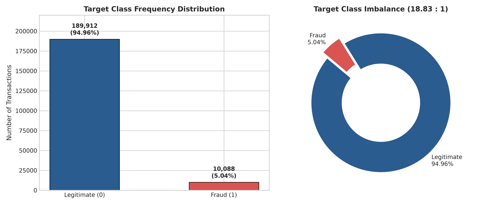
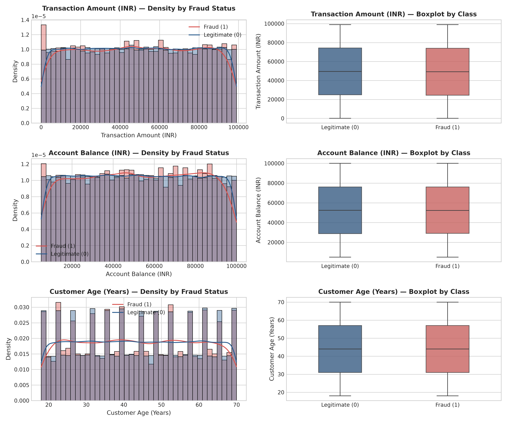
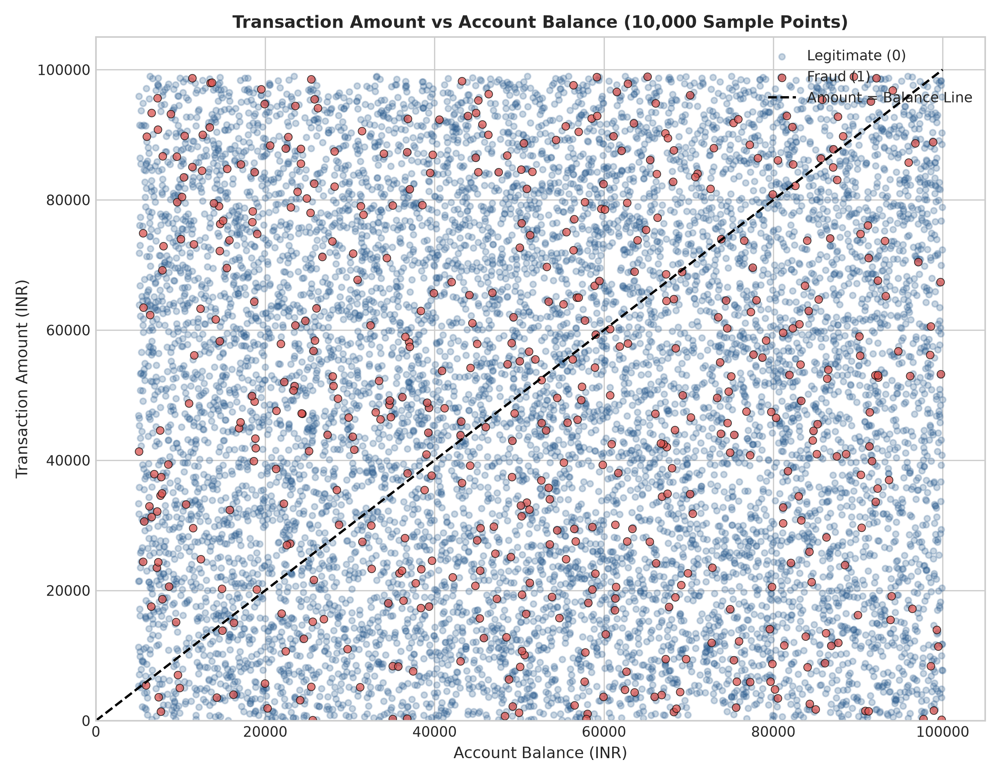
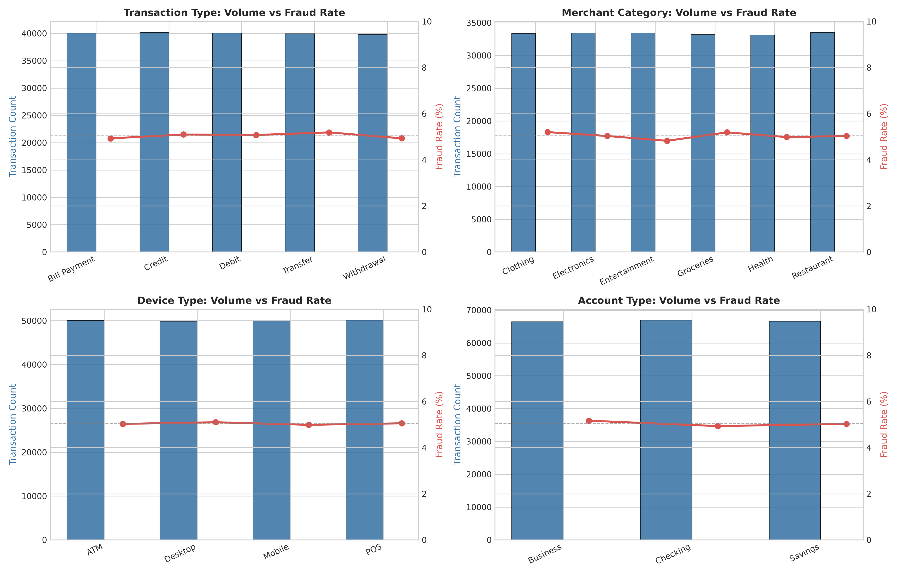
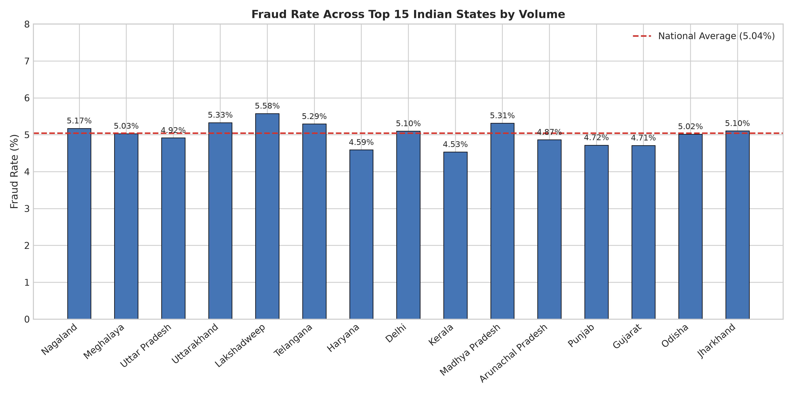
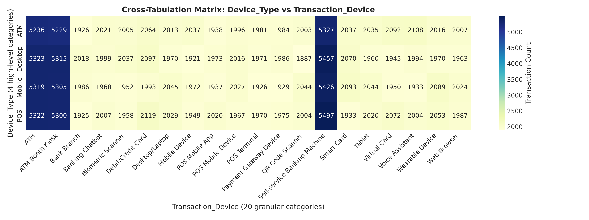
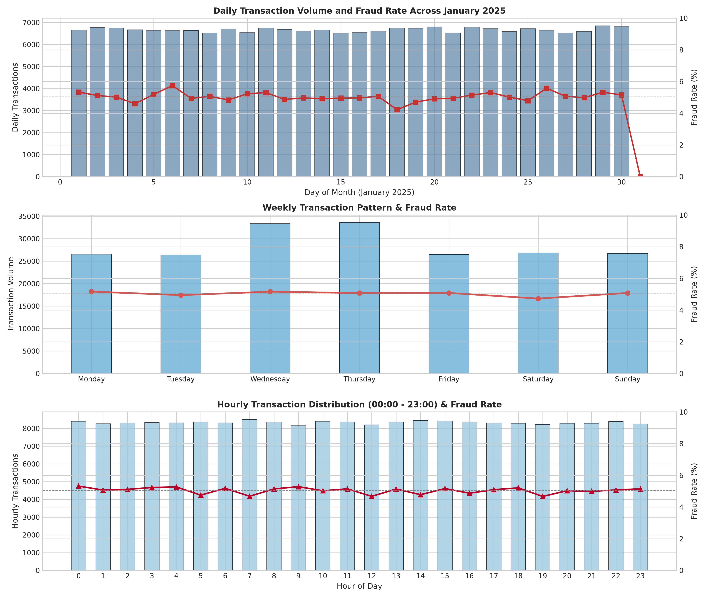
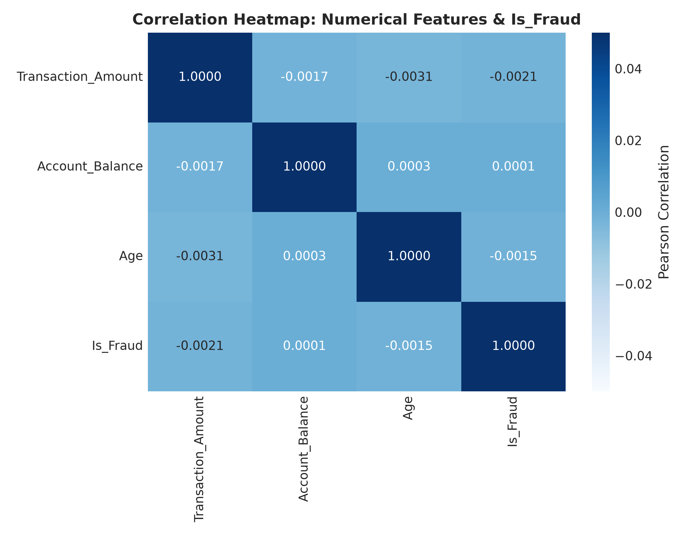

# Phase 1: Exploratory Data Analysis (EDA) Summary Report
**Project:** AI-Based Financial Fraud Detection using TabNet  
**Institution:** B.Tech Final Year Project — ABESEC Ghaziabad, CSE (Session 2026-27)  
**Dataset Analyzed:** `ai/data/raw/Bank_Transaction_Fraud_Detection.csv`  
**Execution Date:** 2026-10-12  
**Analysis Author:** Autonomous Senior AI/ML Engineer  

---

## 1. Executive Summary

This report documents the exhaustive Exploratory Data Analysis (EDA) conducted on the raw Indian banking transaction dataset (`Bank_Transaction_Fraud_Detection.csv`) in Phase 1 of the project. The primary goal is to examine data distributions, evaluate data quality, assess statistical relationships with the fraud target (`Is_Fraud`), audit potential data leakage vectors, and formulate a rigorous, leak-free preprocessing plan for Phase 2.

All statistics reported herein were computed directly from the actual 200,000-row raw dataset using the reproducible script [`ai/src/eda.py`](file:///C:/Projects/FinancialFraudDetection/financial-fraud-tabnet/ai/src/eda.py). The raw dataset was inspected in read-only mode and remains strictly untouched. No models were trained, and no synthetic resampling (SMOTE) was applied during this exploratory phase.

### Key Headline Statistics
- **Total Transactions:** 200,000
- **Total Features:** 24 columns (4 numerical, 20 object/string)
- **Missing Values:** 0 across all 24 columns (0.00%)
- **Exact Duplicate Rows:** 0 (0.00%)
- **Target Distribution:**
  - Legitimate (`Is_Fraud = 0`): 189,912 transactions (94.956%)
  - Fraudulent (`Is_Fraud = 1`): 10,088 transactions (5.044%)
  - **Class Imbalance Ratio:** 18.83 : 1
- **Observation Period:** 31 days (January 1, 2025 – January 31, 2025)
- **Currency:** 100% INR (Indian Rupee)

---

## 2. Dataset Overview & Schema Architecture

The dataset comprises 200,000 transaction records with 24 columns, consuming approximately 93.1 MB of RAM in Pandas.

### Column Specification & Cardinality Audit

| Column Name | Inferred Dtype | Non-Null Count | Unique Count | Distinct Cardinality (%) | Example Values | Functional Role in ML Pipeline |
| :--- | :--- | :--- | :--- | :--- | :--- | :--- |
| `Customer_ID` | `str` (UUID) | 200,000 | 200,000 | 100.00% | `d5f6ec07-...`, `7c14ad51-...` | **Drop** (100% unique identifier; leakage/overfitting risk) |
| `Customer_Name` | `str` | 200,000 | 142,699 | 71.35% | `Osha Tella`, `Krishna Nair` | **Drop** (Direct PII; arbitrary synthetic strings) |
| `Gender` | `str` | 200,000 | 2 | 0.001% | `Male`, `Female` | **Retain** (Categorical demographic feature) |
| `Age` | `int64` | 200,000 | 53 | 0.026% | `18`, `44`, `70` | **Retain** (Continuous numerical feature) |
| `State` | `str` | 200,000 | 34 | 0.017% | `Kerala`, `Maharashtra`, `Bihar` | **Retain** (Categorical geographic feature) |
| `City` | `str` | 200,000 | 145 | 0.072% | `Thiruvananthapuram`, `Nashik` | **Retain** (Categorical geographic feature) |
| `Bank_Branch` | `str` | 200,000 | 145 | 0.072% | `Nashik Branch` | **Drop** (100% redundant with `City + ' Branch'`) |
| `Account_Type` | `str` | 200,000 | 3 | 0.001% | `Savings`, `Checking`, `Business` | **Retain** (Categorical banking profile feature) |
| `Transaction_ID` | `str` (UUID) | 200,000 | 200,000 | 100.00% | `4fa3208f-...`, `c9de0c06-...` | **Drop** (100% unique transaction ID; memorization risk) |
| `Transaction_Date` | `str` (Date) | 200,000 | 31 | 0.015% | `23-01-2025`, `11-01-2025` | **Engineer** (Extract Day, DayOfWeek, Is_Weekend) |
| `Transaction_Time` | `str` (Time) | 200,000 | 77,856 | 38.93% | `16:04:07`, `03:09:52` | **Engineer** (Extract Hour, TimeOfDay, Is_Night) |
| `Transaction_Amount`| `float64` | 200,000 | 197,978 | 98.99% | `32415.45`, `43622.60` | **Retain** (Continuous financial feature; RobustScale) |
| `Merchant_ID` | `str` (UUID) | 200,000 | 200,000 | 100.00% | `214e03c5-...`, `f9e3f11f-...` | **Drop** (100% unique merchant ID; zero repeat visits) |
| `Transaction_Type` | `str` | 200,000 | 5 | 0.002% | `Transfer`, `Debit`, `Credit` | **Retain** (Categorical transaction mechanism) |
| `Merchant_Category`| `str` | 200,000 | 6 | 0.003% | `Restaurant`, `Electronics` | **Retain** (Categorical merchant vertical) |
| `Account_Balance` | `float64` | 200,000 | 197,954 | 98.98% | `74557.27`, `52372.55` | **Retain** (Continuous financial feature; RobustScale) |
| `Transaction_Device`| `str` | 200,000 | 20 | 0.010% | `ATM`, `POS Mobile App`, `Tablet`| **Retain** (Granular device categorical feature) |
| `Transaction_Location`| `str` | 200,000 | 148 | 0.074% | `Nashik, Maharashtra` | **Drop** (100% redundant with `City + ', ' + State`) |
| `Device_Type` | `str` | 200,000 | 4 | 0.002% | `POS`, `ATM`, `Mobile`, `Desktop`| **Retain** (High-level device category) |
| `Is_Fraud` | `int64` | 200,000 | 2 | 0.001% | `0`, `1` | **Target Column** (Binary classification ground truth) |
| `Transaction_Currency`| `str` | 200,000 | 1 | 0.0005% | `INR` | **Drop** (Constant zero-variance column; carries no info) |
| `Customer_Contact` | `str` | 200,000 | 9,000 | 4.50% | `+9198579XXXXXX` | **Drop** (Masked synthetic PII; spurious correlation risk) |
| `Transaction_Description`| `str` | 200,000 | 172 | 0.086% | `Bitcoin transaction`, `Grocery` | **Retain** (Categorical transfer narration) |
| `Customer_Email` | `str` | 200,000 | 4,779 | 2.39% | `oshaXXXXX@XXXXX.com` | **Drop** (Masked synthetic PII derived from first names) |

---

## 3. Data Quality, Missing-Value, and Duplicate Analysis

### 3.1 Completeness (Null Value Audit)
- Every column contains exactly 200,000 non-null records.
- Zero `NaN`, `None`, or empty strings exist in the raw dataset.
- No sentinel values representing missingness (such as `-999`, `?`, `NULL`, `N/A`) were detected in numerical or categorical fields.

### 3.2 Duplicate Analysis
- **Exact duplicate rows:** 0 rows.
- **Duplicate `Transaction_ID`:** 0 rows. Every transaction has a distinct UUIDv4 identifier.
- **Unique `Customer_ID` count:** Exactly 200,000. Every single transaction in the dataset is associated with a distinct customer ID.
- **Unique `Merchant_ID` count:** Exactly 200,000. Every transaction is associated with a unique merchant ID.

### 3.3 Semantic Inconsistencies & Synthetic Properties Discovered
1. **Deterministic Redundancies:**
   - `Bank_Branch` is strictly equal to `City + ' Branch'` for 100% of rows (verified by boolean equality: `(df['Bank_Branch'] == df['City'] + ' Branch').all() == True`).
   - `Transaction_Location` is strictly equal to `City + ', ' + State` for 100% of rows (`(df['Transaction_Location'] == df['City'] + ', ' + df['State']).all() == True`).
   - `Transaction_Currency` is strictly equal to `'INR'` across 100% of rows.
2. **Device Inconsistency / Independent Sampling:**
   - When evaluating `Device_Type` against `Transaction_Device`, contingency analysis demonstrates that categories were sampled independently. For instance, when `Device_Type` is `'ATM'`, `Transaction_Device` includes values such as `'Web Browser'` (2,007 rows), `'Mobile Device'` (2,037 rows), and `'Biometric Scanner'` (2,005 rows). This strongly indicates synthetic generator decoupling rather than physical bank telemetry.
3. **Account Overdraw Patterns:**
   - In 94,071 transactions (47.04% of the entire dataset), `Transaction_Amount > Account_Balance`. In standard banking systems without pre-approved overdraft limits, debit/withdrawal transactions exceeding balance fail. However, in this dataset, these transactions are recorded as completed, and their fraud rate (5.00%) is virtually identical to transactions where balance exceeds amount (5.08%).
4. **Synthetic PII Structure:**
   - `Customer_Email` contains only 4,779 unique values because emails were generated by taking the customer's first name in lowercase and appending fixed masks (e.g., `Krishna Nair` $\rightarrow$ `krishnaXXX@XXXXX.com`).
   - `Customer_Contact` contains only 9,000 unique values, formed by `+919` followed by a random 4-digit prefix and six `X` characters (`+919XXXXXXXXXX`).

---

## 4. Target Distribution (`Is_Fraud`)

The target variable is binary, where `0` designates a legitimate transaction and `1` designates a confirmed fraudulent transaction.

```
Total Transactions : 200,000
Legitimate (0)     : 189,912  (94.956%)
Fraudulent (1)     :  10,088  ( 5.044%)
Imbalance Ratio    : 18.8255 : 1
```



### Machine Learning Implications
1. **Misleading Accuracy:** A naive majority-class classifier that predicts all transactions as legitimate achieves an accuracy of **94.96%** while failing to catch a single fraudulent event.
2. **Metric Selection:** Model optimization and model selection must rely on **PR-AUC (Precision-Recall Area Under Curve)**, **ROC-AUC**, **Recall at False Positive Rate $\le$ 1%**, and **F1-Macro**.
3. **Resampling Protocol:** Imbalanced handling techniques (such as SMOTE or class-weighting) must be applied **strictly within the training fold** of cross-validation during Phase 3 to avoid data leakage into validation folds.

---

## 5. Numerical Feature Analysis

The dataset contains three continuous numerical features: `Age`, `Transaction_Amount`, and `Account_Balance`.

### 5.1 Descriptive Statistics & Stratified Breakdown

| Feature | Segment | Mean | Std Dev | Min | 25th % | Median | 75th % | 99th % | Max | Skewness | Kurtosis |
| :--- | :--- | :--- | :--- | :--- | :--- | :--- | :--- | :--- | :--- | :--- | :--- |
| **Transaction_Amount** (INR) | Overall | 49,538.02 | 28,551.87 | 10.29 | 24,851.34 | 49,502.44 | 74,314.62 | 97,989.52 | 98,999.98 | -0.0005 | -1.1982 |
| | Legitimate (0) | 49,551.83 | 28,541.88 | 10.29 | 24,877.68 | 49,517.42 | 74,326.87 | 97,981.10 | 98,999.98 | — | — |
| | Fraud (1) | 49,277.93 | 28,739.52 | 10.41 | 24,420.04 | 49,162.94 | 74,068.72 | 98,082.25 | 98,999.02 | — | — |
| **Account_Balance** (INR) | Overall | 52,437.99 | 27,399.51 | 5,000.82 | 28,742.40 | 52,372.56 | 76,147.67 | 99,058.32 | 99,999.95 | +0.0039 | -1.1977 |
| | Legitimate (0) | 52,437.20 | 27,404.83 | 5,000.82 | 28,723.89 | 52,373.72 | 76,148.88 | 99,058.25 | 99,998.68 | — | — |
| | Fraud (1) | 52,452.89 | 27,300.47 | 5,003.42 | 29,122.99 | 52,344.73 | 76,116.03 | 99,052.65 | 99,999.95 | — | — |
| **Age** (Years) | Overall | 44.02 | 15.29 | 18.00 | 31.00 | 44.00 | 57.00 | 70.00 | 70.00 | +0.0026 | -1.2003 |
| | Legitimate (0) | 44.02 | 15.29 | 18.00 | 31.00 | 44.00 | 57.00 | 70.00 | 70.00 | — | — |
| | Fraud (1) | 43.91 | 15.27 | 18.00 | 31.00 | 44.00 | 57.00 | 70.00 | 70.00 | — | — |



### 5.2 Hypothesis Testing & Correlation
Statistical tests comparing legitimate vs fraudulent distributions reveal no statistically significant univariate difference across any of the continuous features:
- **Transaction Amount:** Two-sample $t$-test: $t = -0.9389, p = 0.3478$; Mann-Whitney $U$: $p = 0.3494$; ANOVA $F = 0.8816, p = 0.3478$. Pearson correlation with `Is_Fraud` is $-0.0021$.
- **Account Balance:** Two-sample $t$-test: $t = 0.0561, p = 0.9553$; Mann-Whitney $U$: $p = 0.9542$; ANOVA $F = 0.0031, p = 0.9553$. Pearson correlation with `Is_Fraud` is $+0.0001$.
- **Age:** Two-sample $t$-test: $t = -0.6786, p = 0.4974$; Mann-Whitney $U$: $p = 0.4976$; ANOVA $F = 0.4605, p = 0.4974$. Pearson correlation with `Is_Fraud` is $-0.0015$.

### 5.3 Distribution Shape & Outlier Assessment
- All three numerical features exhibit near-zero skewness ($\approx 0.00$) and negative kurtosis ($\approx -1.20$), which is the classic mathematical signature of a **continuous uniform distribution** ($Kurtosis_{uniform} = -1.2$).
- `Transaction_Amount` is uniformly distributed across $[10, 99000]$.
- `Account_Balance` is uniformly distributed across $[5000, 100000]$.
- `Age` is uniformly distributed across integer values from $18$ to $70$.
- No negative amounts or account balances exist. Zero values do not exist.
- Because data is bounded and uniformly distributed without long tails, traditional extreme-value outlier clipping is not required; `RobustScaler` remains ideal to map features cleanly to interquartile ranges.



---

## 6. Categorical Feature Analysis

The dataset includes several discrete categorical features representing the transaction context: `Transaction_Type`, `Merchant_Category`, `Device_Type`, `Account_Type`, and `Gender`.



### 6.1 Contingency & Significance Testing

| Categorical Feature | Cardinality | Class Volumes & Percentages | Fraud Rate Range (%) | Chi-Square ($\chi^2$) | p-value | Degrees of Freedom | Cramér's V |
| :--- | :--- | :--- | :--- | :--- | :--- | :--- | :--- |
| **Transaction_Type** | 5 | Credit: 20.09%, Debit: 20.03%, Bill Pay: 20.02%, Transfer: 19.98%, Withdrawal: 19.89% | 4.93% – 5.19% | 4.2796 | 0.3695 | 4 | 0.0046 |
| **Merchant_Category** | 6 | Restaurant: 16.76%, Entertainment: 16.71%, Electronics: 16.70%, Clothing: 16.67%, Groceries: 16.59%, Health: 16.56% | 4.82% – 5.20% | 6.8211 | 0.2343 | 5 | 0.0058 |
| **Device_Type** | 4 | POS: 25.06%, ATM: 25.03%, Mobile: 24.98%, Desktop: 24.94% | 4.99% – 5.10% | 0.6768 | 0.8786 | 3 | 0.0018 |
| **Account_Type** | 3 | Checking: 33.46%, Savings: 33.30%, Business: 33.24% | 4.94% – 5.17% | 3.8200 | 0.1481 | 2 | 0.0044 |
| **Gender** | 2 | Male: 50.23%, Female: 49.77% | 5.03% – 5.06% | 0.0784 | 0.7795 | 1 | 0.0006 |
| **Transaction_Device** | 20 | 20 granular devices (~4% to ~10.8% each) | 4.65% – 5.50% | 19.2654 | 0.4399 | 19 | 0.0098 |
| **State** | 34 | 34 Indian states/UTs | 4.22% – 5.92% | 30.4496 | 0.5947 | 33 | 0.0123 |
| **City** | 145 | 145 Indian cities | 3.25% – 7.12% | 153.7181 | 0.2745 | 144 | 0.0277 |
| **Transaction_Description**| 172 | 172 transaction narratives | 3.66% – 6.42% | 150.9276 | 0.8632 | 171 | 0.0275 |




### Key Categorical Observations
- All primary categorical features have almost perfectly balanced frequency partitions (e.g., 20% each for the 5 transaction types, 16.6% each for the 6 merchant categories, 25% each for the 4 device types).
- In every category, the empirical fraud rate oscillates tightly around the population prior of **5.04%**.
- All Chi-square $p$-values are well above the significance threshold of $\alpha = 0.05$. Cramér's V association coefficients are all negligible ($V < 0.03$), indicating that no single categorical feature exhibits significant linear or direct marginal association with the fraud outcome.

---

## 7. Temporal Pattern Analysis

The dataset spans all 31 calendar days of **January 2025** (`2025-01-01` to `2025-01-31`).



### 7.1 Daily & Weekly Patterns
- **Daily Volume:** Daily transaction volume ranges between 6,290 and 6,705 transactions per day ($\mu \approx 6,451$). Daily fraud rates range from 4.22% to 5.75% ($\chi^2 = 33.04, p = 0.3210$).
- **Day of the Week:** Volume is distributed across weekdays:
  - Thursday: 33,581 transactions (Fraud rate: 5.08%)
  - Wednesday: 33,340 transactions (Fraud rate: 5.17%)
  - Saturday: 26,884 transactions (Fraud rate: 4.73%)
  - Sunday: 26,711 transactions (Fraud rate: 5.08%)
  - Monday: 26,557 transactions (Fraud rate: 5.17%)
  - Friday: 26,492 transactions (Fraud rate: 5.08%)
  - Tuesday: 26,435 transactions (Fraud rate: 4.95%)
  - Chi-square test: $p = 0.7673$ (no significant day-of-week clustering).

### 7.2 Hourly Patterns
- **Time Representation:** `Transaction_Time` is formatted as `HH:MM:SS`. Across all 24 hours (00:00 to 23:00), transaction volume is remarkably uniform: each hour contains between 8,224 and 8,399 transactions.
- **Hourly Fraud Rates:** Fraud rates vary between 4.67% (Hour 19) and 5.32% (Hour 00). Chi-square test across all 24 hours yields $\chi^2 = 16.09, p = 0.8515$. Nighttime hours (00:00–05:00) do not exhibit significant fraud spikes in this dataset compared to daytime.

---

## 8. Correlation Analysis



### Pearson Correlation Matrix
```
                    Age   Tx_Amount   Acct_Balance   Is_Fraud
Age              1.0000     -0.0031        +0.0003    -0.0015
Tx_Amount       -0.0031      1.0000        -0.0017    -0.0021
Acct_Balance    +0.0003     -0.0017         1.0000    +0.0001
Is_Fraud        -0.0015     -0.0021        +0.0001     1.0000
```
- Correlations between all pairs of continuous features and the target `Is_Fraud` are practically zero ($|r| \le 0.0031$).
- Spearman rank correlation coefficients yield identical conclusions ($|r_s| \le 0.0031$).
- Multicollinearity between input numerical features is non-existent.

---

## 9. Potential Data Leakage Risks & Model Integrity

Data leakage occurs when information from outside the training dataset or variables unavailable at test/inference time are inadvertently incorporated into model training. The following risks were identified:

1. **High-Cardinality Identifiers (`Customer_ID`, `Transaction_ID`, `Merchant_ID`):**
   - Each of these columns has exactly 200,000 unique values (100% uniqueness).
   - If passed into decision trees, gradient boosters, or deep neural networks, models can memorize specific UUID strings or their hash values. In production, unseen customers or transactions will have unseen UUIDs, leading to catastrophic failure of generalization.
   - **Remediation:** Strictly drop `Customer_ID`, `Transaction_ID`, and `Merchant_ID`.
2. **Direct / Masked PII (`Customer_Name`, `Customer_Contact`, `Customer_Email`):**
   - These features carry no legitimate domain causal signal for credit card or banking transaction fraud.
   - Retaining masked strings could cause tree algorithms to split on arbitrary email prefixes (e.g., `krishnaXXX@...`), learning spurious associations.
   - **Remediation:** Strictly drop all customer contact and identity strings.
3. **Deterministic Structural Redundancies (`Bank_Branch`, `Transaction_Location`, `Transaction_Currency`):**
   - `Bank_Branch` is identical to `City + ' Branch'`.
   - `Transaction_Location` is identical to `City + ', ' + State`.
   - `Transaction_Currency` is constant `'INR'` with zero entropy.
   - **Remediation:** Drop `Bank_Branch`, `Transaction_Location`, and `Transaction_Currency` to eliminate redundant multicollinearity.
4. **Data Splitting & Transformation Leakage:**
   - Preprocessing artifacts (encoders, scalers, imputers) must **never** be fitted on the entire dataset prior to splitting.
   - In Phase 2 and Phase 3, all scalers (`RobustScaler`) and encoders (`OrdinalEncoder` for TabNet) must be fitted solely on the training fold during Cross-Validation.

---

## 10. Summary of Generated Visualizations

All diagnostic plots have been generated and saved under `ai/reports/figures/`:

1. [`01_target_distribution.png`](file:///C:/Projects/FinancialFraudDetection/financial-fraud-tabnet/ai/reports/figures/01_target_distribution.png): Dual visualization (bar chart + donut chart) illustrating class imbalance ($94.96\%$ vs $5.04\%$).
2. [`02_numerical_distributions.png`](file:///C:/Projects/FinancialFraudDetection/financial-fraud-tabnet/ai/reports/figures/02_numerical_distributions.png): $3 \times 2$ grid displaying KDE histograms and boxplots for `Transaction_Amount`, `Account_Balance`, and `Age` segmented by fraud class.
3. [`03_categorical_distributions.png`](file:///C:/Projects/FinancialFraudDetection/financial-fraud-tabnet/ai/reports/figures/03_categorical_distributions.png): $2 \times 2$ twin-axis charts displaying transaction volumes and empirical fraud rates across `Transaction_Type`, `Merchant_Category`, `Device_Type`, and `Account_Type`.
4. [`04_temporal_analysis.png`](file:///C:/Projects/FinancialFraudDetection/financial-fraud-tabnet/ai/reports/figures/04_temporal_analysis.png): 3-panel temporal breakdown covering daily volume/fraud in January 2025, day-of-week distribution, and hourly distribution (00:00 to 23:00).
5. [`05_amount_vs_balance.png`](file:///C:/Projects/FinancialFraudDetection/financial-fraud-tabnet/ai/reports/figures/05_amount_vs_balance.png): Scatter plot of `Transaction_Amount` vs `Account_Balance` showing the $Amount = Balance$ overdraw threshold and fraud points.
6. [`06_correlation_heatmap.png`](file:///C:/Projects/FinancialFraudDetection/financial-fraud-tabnet/ai/reports/figures/06_correlation_heatmap.png): Pearson correlation matrix highlighting near-zero linear dependence among numerical variables and the target.
7. [`07_geographic_fraud_rate.png`](file:///C:/Projects/FinancialFraudDetection/financial-fraud-tabnet/ai/reports/figures/07_geographic_fraud_rate.png): Bar chart of fraud rates across the top 15 Indian states by volume against the 5.04% national baseline.
8. [`08_device_matrix_heatmap.png`](file:///C:/Projects/FinancialFraudDetection/financial-fraud-tabnet/ai/reports/figures/08_device_matrix_heatmap.png): Cross-tabulation heatmap comparing the 4 `Device_Type` categories against the 20 `Transaction_Device` categories.

---

## 11. Recommended Preprocessing Architecture (Phase 2 Roadmap)

Based on the empirical findings from Phase 1 EDA, the recommended preprocessing pipeline for Phase 2 is specified below:

```
Raw Dataset (200,000 rows x 24 columns)
  │
  ├── 1. Drop Leakage / Redundant Columns (9 columns):
  │     - Identifiers: Transaction_ID, Customer_ID, Merchant_ID
  │     - PII: Customer_Name, Customer_Contact, Customer_Email
  │     - Redundant: Bank_Branch, Transaction_Location
  │     - Constant: Transaction_Currency
  │
  ├── 2. Feature Engineering (5 engineered features):
  │     - Amount_to_Balance_Ratio = Transaction_Amount / (Account_Balance + 1.0)
  │     - Amount_Exceeds_Balance = (Transaction_Amount > Account_Balance).astype(int)
  │     - Tx_Hour = Hour of transaction (0 to 23)
  │     - Tx_DayOfWeek = Day of week (0 to 6)
  │     - Is_Weekend = (Tx_DayOfWeek >= 5).astype(int)
  │     - Is_Night = (Tx_Hour in [23, 0, 1, 2, 3, 4, 5]).astype(int)
  │
  ├── 3. Feature Partitioning:
  │     - Categoricals: Gender, State, City, Account_Type, Transaction_Type, 
  │                     Merchant_Category, Device_Type, Transaction_Device, 
  │                     Transaction_Description
  │     - Numericals: Age, Transaction_Amount, Account_Balance, 
  │                   Amount_to_Balance_Ratio, Tx_Hour, Tx_DayOfWeek
  │     - Binary Indicators: Amount_Exceeds_Balance, Is_Weekend, Is_Night
  │
  ├── 4. Encoding & Scaling (Fit on Train Fold Only):
  │     - TabNet Pipeline: OrdinalEncoder (records categorical dimensions for embedding matrices)
  │     - Baseline/Tree Pipeline: Target / Frequency or One-Hot Encoding
  │     - Numerical Scaling: RobustScaler (resilient to uniform extremes)
  │
  └── 5. Validation Architecture:
        - Stratified 5-Fold Cross-Validation (preserves 5.04% fraud ratio in each fold)
        - Strict fold isolation: zero leakages across splits
```

---

## 12. Limitations and Next Steps

### Limitations Identified
1. **Synthetic Nature of Dataset:** The distributions across days, hours, and categories exhibit strong uniformity, and univariate tests indicate no strong direct linear signals. This suggests the dataset was generated using synthetic simulation tools. Models will need to search for non-linear, multi-feature interactions.
2. **Absence of Customer History:** Because each customer appears exactly once (`Customer_ID` has 200,000 unique values), aggregate behavioral features (such as 30-day transaction frequency, velocity, average historical spend) cannot be computed on this dataset.
3. **Temporal Span:** The data represents only one month (January 2025), preventing multi-month seasonality analysis.

### Next Steps (Transitioning to Phase 2)
1. Implement the preprocessing pipeline in [`ai/src/preprocessing.py`](file:///C:/Projects/FinancialFraudDetection/financial-fraud-tabnet/ai/src/preprocessing.py).
2. Establish the stratified cross-validation split generator in [`ai/src/cv_pipeline.py`](file:///C:/Projects/FinancialFraudDetection/financial-fraud-tabnet/ai/src/cv_pipeline.py).
3. Update [`tests/ai/test_cv_pipeline.py`](file:///C:/Projects/FinancialFraudDetection/financial-fraud-tabnet/tests/ai/test_cv_pipeline.py) with assertions verifying zero data leakage across folds.
4. Record baseline dataset metadata in [`ai/data/data_dictionary.md`](file:///C:/Projects/FinancialFraudDetection/financial-fraud-tabnet/ai/data/data_dictionary.md).
